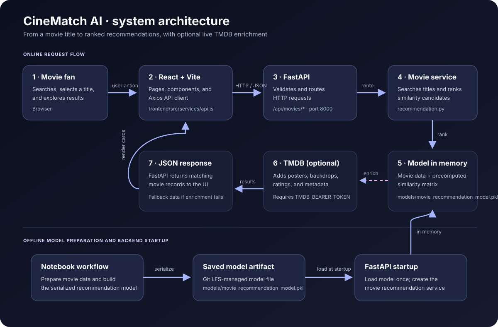

<p align="center">
  
</p>

<h1 align="center">🎬 CineMatch AI</h1>

<p align="center">
  Discover movies that feel like your next favorite.
  <br>
  A movie discovery app combining a content-based recommendation model, a FastAPI service, a React interface, and TMDB metadata.
</p>

<p align="center">
  
  
  
  
  
  
</p>

<p align="center">
  <a href="#-getting-started">Get started</a> ·
  <a href="#-how-the-app-works">How it works</a> ·
  <a href="#-api-reference">API reference</a> ·
  <a href="#-contributing">Contributing</a>
</p>

---

## Contents

- [What is CineMatch AI?](#-what-is-cinematch-ai)
- [Features](#-features)
- [How the app works](#-how-the-app-works)
- [Recommendation flow](#recommendation-request-flow)
- [Technology](#️-technology)
- [Getting started](#-getting-started)
- [API reference](#-api-reference)
- [Project layout](#-project-layout)
- [Troubleshooting](#-troubleshooting)
- [Roadmap](#-roadmap)
- [Contributing](#-contributing)
- [License and credits](#-license-and-credits)

---

## 🍿 What is CineMatch AI?

CineMatch AI helps you explore movies through recommendations based on a movie you already enjoy. Its Python recommendation service loads a precomputed movie dataset and similarity matrix. The React app calls the FastAPI backend, while the backend can enrich returned movie records with posters and other metadata from TMDB.

The repository also includes a Jupyter notebook for the machine-learning work and a separate Streamlit `app.py` entry point. The current web application is split into `frontend/` and `backend/`.

## ✨ Features

- **Similar-movie recommendations** based on a selected title
- **Movie search** across the model's movie dataset
- **Popular and top-rated** movie collections
- **Movie discovery pages** for browsing and viewing details
- **TMDB enrichment** for posters, backdrops, ratings, and related metadata when available
- **Watchlist interface** in the React application
- **Interactive API documentation** generated by FastAPI
- **Preloaded model** so the recommendation model is loaded once when the backend starts

> Availability of a movie's TMDB enrichment depends on a valid token, network access, and TMDB returning a match. The recommendation service has fallback behavior when enrichment is unavailable.

## 🧭 How the app works

### System architecture



### Recommendation request flow

1. The user searches for or selects a movie in the React interface.
2. The frontend sends an HTTP request to the FastAPI application.
3. FastAPI routes the request to the movie service.
4. For recommendations, the service resolves the title against the loaded movie list and ranks candidates using the precomputed similarity matrix.
5. The service enriches returned movie data through TMDB when needed and when credentials are available.
6. FastAPI returns JSON to the frontend, which renders the movie results.

### Model lifecycle

- **Training/preparation:** The repository's Jupyter notebook contains the offline machine-learning workflow. The serialized model is stored at `models/movie_recommendation_model.pkl`.
- **Application startup:** `backend/main.py` loads the model once and creates the recommendation service.
- **Request time:** The service finds the selected movie and sorts its similarity scores to return recommendations.

The recommendation code consumes a stored movie table and similarity matrix. The exact feature engineering and similarity metric should be taken from the notebook/model training code; this README does not assume a particular vectorizer or metric.

## 🖥️ Technology

| Area | Tools |
|---|---|
| Web UI | React 19, JavaScript, Vite, Axios |
| API | Python, FastAPI, Uvicorn |
| Recommendation service | Pandas, NumPy, scikit-learn, Joblib |
| Movie metadata | TMDB API |
| Model artifact | `models/movie_recommendation_model.pkl` |
| ML exploration | Jupyter Notebook |

## 🚀 Getting started

### Prerequisites

- Python 3.10 or newer
- Node.js and npm (use a version compatible with the Vite version in `frontend/package.json`)
- Git and [Git LFS](https://git-lfs.com/)
- A TMDB API Read Access Token for live TMDB enrichment

### 1. Clone the project and fetch the model

Install Git LFS before cloning so Git can retrieve the model artifact:

```bash
git lfs install
git clone https://github.com/im-vishal-jain/CineMatch-AI-movie-recomendation.git
cd CineMatch-AI-movie-recomendation
git lfs pull
```

### 2. Configure the TMDB token

Create a `.env` file in the repository root:

```env
TMDB_BEARER_TOKEN=your_tmdb_api_read_access_token
```

The backend reads this variable from the root `.env`. Never commit your real token. Without it, live TMDB requests cannot authenticate.

### 3. Install and start the backend

Create a virtual environment and install backend dependencies. The TMDB client also imports `requests` and `python-dotenv`; install these explicitly because they are not currently listed in `backend/requirements.txt`:

```bash
python -m venv .venv
```

```bash
# macOS / Linux
source .venv/bin/activate

# Windows PowerShell
.venv\Scripts\Activate.ps1
```

```bash
python -m pip install -r backend/requirements.txt requests python-dotenv
python -m uvicorn backend.main:app --reload --port 8000
```

The commands must be run from the repository root. Once the server starts, open:

- API root: <http://127.0.0.1:8000/>
- Health check: <http://127.0.0.1:8000/health>
- Swagger UI: <http://127.0.0.1:8000/docs>
- ReDoc: <http://127.0.0.1:8000/redoc>

### 4. Install and start the frontend

In a second terminal:

```bash
cd frontend
npm install
npm run dev
```

Open the local address printed by Vite (typically <http://localhost:5173>). The current frontend API client uses `http://127.0.0.1:8000/api` as its base URL.

### Useful frontend scripts

Run these from `frontend/`:

```bash
npm run dev      # start the local development server
npm run build    # create a production build
npm run preview  # preview the production build
npm run lint     # run Oxlint
```

## 🔌 API reference

The FastAPI router is mounted at `/api/movies`. These are the endpoints currently implemented in `backend/app/routes/movies.py`:

| Method | Endpoint | Query parameters | Purpose |
|---|---|---|---|
| `GET` | `/api/movies/recommend` | Required: `title`; optional: `limit` (default 10, range 1–20) | Recommend similar movies. Returns 404 if the title cannot be resolved. |
| `GET` | `/api/movies/popular` | Optional: `limit` (default 10) | Return movies sorted by popularity. |
| `GET` | `/api/movies/top-rated` | Optional: `limit` (default 10) | Return movies with at least 100 votes, sorted by rating. |
| `GET` | `/api/movies/search` | Required: `q`; optional: `limit` (default 10, range 1–30) | Search titles in the loaded movie dataset. |

### Example requests

```bash
# Get recommendations for The Matrix
curl --get 'http://127.0.0.1:8000/api/movies/recommend' \
  --data-urlencode 'title=The Matrix' \
  --data-urlencode 'limit=10'

# Search titles (the backend query parameter is q)
curl --get 'http://127.0.0.1:8000/api/movies/search' \
  --data-urlencode 'q=matrix'

# Popular movies
curl 'http://127.0.0.1:8000/api/movies/popular?limit=10'

# Top-rated movies
curl 'http://127.0.0.1:8000/api/movies/top-rated?limit=10'
```

Responses are JSON. For the complete interactive schema, run the backend and visit `/docs`.

> **Frontend integration note:** The current API client in `frontend/src/services/api.js` sends search as `query` and defines movie-details calls, while the backend routes currently accept search as `q` and do not implement a movie-details route. The endpoint table above describes the backend implementation. Aligning those frontend calls with the backend is a follow-up integration task.

## 🗂️ Project layout

```text
.
├── backend/
│   ├── app/
│   │   ├── core/
│   │   │   ├── model_loader.py       # Loads the serialized model
│   │   │   └── tmdb_client.py        # TMDB API and image URL helpers
│   │   ├── routes/
│   │   │   └── movies.py             # FastAPI movie endpoints
│   │   └── services/
│   │       └── recommendation.py    # Title matching, ranking, enrichment
│   ├── main.py                       # FastAPI app and startup lifecycle
│   └── requirements.txt              # Backend Python dependencies
├── frontend/
│   ├── src/
│   │   ├── components/               # Shared UI components
│   │   ├── pages/                    # Home, Discover, Genres, etc.
│   │   ├── services/api.js           # HTTP client for the backend
│   │   └── App.jsx                   # Application page routing/state
│   ├── package.json
│   └── vite.config.js
├── models/
│   └── movie_recommendation_model.pkl
├── docs/
│   ├── banner.svg
│   └── workflow.svg                 # Architecture and request flow
├── Movie_Recommendation_System_using_Machine_Learning_with_Python 2.ipynb
├── app.py                            # Separate Streamlit application
├── requirements.txt                  # Root/Streamlit dependencies
└── README.md
```

## 🩺 Troubleshooting

| Problem | What to check |
|---|---|
| Backend says the model is missing or it is only a small pointer file | Run `git lfs install` and `git lfs pull`; confirm the model file was downloaded. |
| `ModuleNotFoundError: requests` or `dotenv` | Activate the virtual environment and install `requests` and `python-dotenv` as shown above. |
| TMDB returns 401 | Verify the root `.env` contains a valid TMDB API Read Access Token in `TMDB_BEARER_TOKEN`. Restart the backend after changing it. |
| Frontend cannot connect to the API | Start FastAPI on port 8000 and check the URL in `frontend/src/services/api.js`. |
| Movie search fails from the UI | The backend expects the search parameter `q`; see the frontend integration note and API docs. |
| `No module named backend` | Run Uvicorn from the repository root with `python -m uvicorn backend.main:app`. |
| Browser reports a CORS error | The backend currently allows the Vite origins `localhost:5173` and `localhost:5174`; use one of these or update the backend CORS configuration. |

## 🛣️ Roadmap

- [ ] Align frontend API calls with the implemented backend routes
- [ ] Add or remove unimplemented frontend API features (such as movie details) consistently
- [ ] Document and evaluate the model's feature engineering and recommendation quality
- [ ] Add automated tests for API routes and recommendation ranking
- [ ] Add configuration for frontend/backend URLs
- [ ] Add Docker support and deployment instructions
- [ ] Explore hybrid or embedding-based recommendations

## 🤝 Contributing

Contributions, bug reports, and suggestions are welcome:

1. Open an issue describing the proposed change or problem.
2. Create a focused branch for your change.
3. Test the relevant backend or frontend behavior.
4. Open a pull request with a concise description and screenshots when the UI changes.

## 📄 License and credits

This project is licensed under the MIT License; see [`LICENSE`](LICENSE).

Movie metadata and images are provided through [The Movie Database (TMDB)](https://www.themoviedb.org/). This product uses the TMDB API but is not endorsed or certified by TMDB.

## 👨‍💻 Author

**Vishal Kumar** · [GitHub @im-vishal-jain](https://github.com/im-vishal-jain)

---

<p align="center">If CineMatch AI helps you find your next movie, consider giving the repository a ⭐</p>
